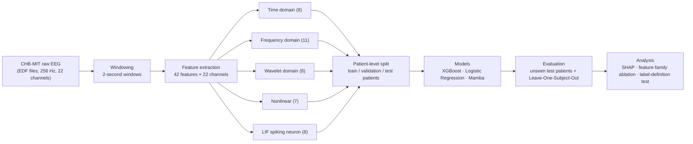
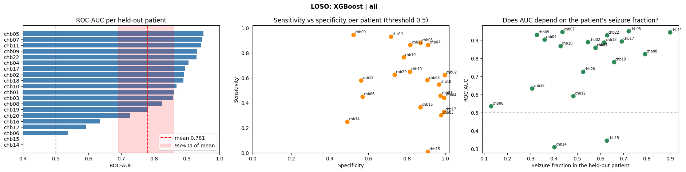

<div align="center">

# 🧠 Multi-Domain Feature Engineering and Stacked Ensemble Learning for Epileptic Seizure Detection

**Official code for the paper published in _Neuroscience Informatics_ (Elsevier, 2026)**

[](https://www.sciencedirect.com/science/article/pii/S2772528626000464)
[](https://physionet.org/content/chbmit/1.0.0/)
[](https://www.python.org/)
[](https://www.kaggle.com/)

**Md Sumon Hossain**<sup>✉</sup> · **Md. Adnan Abdullah Sadi** · **Abul Kalam Al Azad**

Department of Mathematics and Physics, North South University, Dhaka-1229, Bangladesh

<sup>✉</sup> Corresponding author

[📄 Read the paper](https://www.sciencedirect.com/science/article/pii/S2772528626000464) ·
[🚀 Quick start](#-quick-start) ·
[📊 Results](#-results) ·
[📝 Citation](#-citation)

</div>

---

## 📌 Overview

Detecting epileptic seizures automatically from scalp **electroencephalography (EEG)** — the recording of the brain's electrical activity through electrodes on the scalp — is hard because every patient's brain signals look different. This repository contains the full pipeline behind our paper: from raw CHB-MIT recordings to features, models, and a strict **patient-level evaluation** in which the model is always tested on people it has never seen.

**Main ideas**

- 🧩 **Multi-domain features.** Every 2-second EEG window is described by **42 features per channel** across **22 channels** (924 features in total), taken from five families: time, frequency, wavelet, nonlinear, and spiking-neuron features.
- ⚡ **Spiking-neuron features.** Each EEG channel is fed as input current into a **Leaky Integrate-and-Fire (LIF) neuron** — a simple mathematical model of a biological neuron that "fires" a spike when its voltage crosses a threshold. Eight statistics of the resulting spike train (firing rate, burst structure, spike-timing regularity, spike-count entropy, …) form an extra feature family.
- 🌳 **Interpretable classical models.** Gradient-boosted decision trees (XGBoost), logistic regression, and an optional Mamba sequence model, with optional automatic hyperparameter search (Optuna).
- 🔒 **Leakage-free, patient-level evaluation.** Windows from one patient never appear in both training and testing. Results are reported on unseen test patients and with **Leave-One-Subject-Out** cross-validation, with per-patient scores and confidence intervals.
- 🔍 **Explainability and ablations.** SHAP explanations computed per fold, ablation of each feature family, and a test of how the seizure-label definition affects performance.

---

## 🗺️ Pipeline



---

## 🧪 Feature families

| Family | Count | Features |
|---|:---:|---|
| ⏱️ **Time domain** | 8 | skewness, kurtosis, zero-crossing rate, peak-to-peak amplitude, curve length, Hjorth mobility, Hjorth complexity, interquartile range |
| 📈 **Frequency domain** | 11 | delta / theta / alpha / beta / gamma band power, mean frequency, dominant frequency, spectral entropy, alpha-to-beta ratio, spectral flatness, 95% spectral edge frequency |
| 🌊 **Wavelet domain** (Daubechies-4, 4 levels) | 8 | energy of detail levels 1–4, wavelet entropy, total wavelet energy, high-frequency energy ratio, wavelet standard deviation |
| 🌀 **Nonlinear** | 7 | permutation entropy, Petrosian fractal dimension, nonlinear energy operator (mean and standard deviation), Hilbert amplitude, Hilbert phase variability, crest factor |
| ⚡ **LIF spiking neuron** | 8 | spike rate, mean / standard deviation / coefficient of variation of the inter-spike interval, burst index, mean burst length, silent fraction, spike-count entropy |

**Windowing.** Windows are 2 seconds long (512 samples). Windows around seizures overlap by 90%, other windows by 50%. The seizure label covers the annotated seizure plus 10 s before onset and 5 s after offset; the column `in_core_ictal` marks windows that fall inside the true seizure interval only.

---

## 🔒 Evaluation protocol

Because neighbouring, overlapping windows are almost identical, a random window-level split lets the model "see" the test patient during training and inflates the scores. Every experiment here therefore splits **by patient**.

| Setting | Training patients | Validation patients | Test patients |
|---|---|---|---|
| **Fixed patient split** | chb01 – chb12 | chb14, chb15 (decision threshold only) | chb16, chb17, chb18, chb19, chb20, chb22 |
| **Leave-One-Subject-Out** | all others | 2 other patients (threshold only) | each of the 20 patients, once |

- chb21 is the same person as chb01, and chb17a/b/c are one person, so they are merged — giving **20 distinct patients**.
- In every fold, the missing-value imputer, the scaler, the model, and the decision threshold are fitted **without** the held-out patient.
- The decision threshold is chosen on validation patients by **balanced accuracy** (the average of sensitivity and specificity), then frozen.
- Results are reported as mean ± standard deviation across patients with **95% bootstrap confidence intervals**, plus every patient individually.

---

## 📊 Results

Leave-One-Subject-Out with XGBoost (default parameters) on all 42 × 22 features, 20 held-out patients:

| Metric (mean across patients) | Value | 95% confidence interval |
|---|:---:|:---:|
| **ROC-AUC** | **0.781 ± 0.196** | 0.691 – 0.859 |
| Precision-recall AUC | 0.792 ± 0.248 | 0.677 – 0.889 |
| Sensitivity (threshold 0.5) | 0.573 ± 0.254 | 0.464 – 0.679 |
| Specificity (threshold 0.5) | 0.819 ± 0.168 | 0.745 – 0.887 |
| Balanced accuracy (threshold 0.5) | 0.696 ± 0.137 | 0.635 – 0.753 |

On the fixed split (six unseen test patients), XGBoost reaches a ROC-AUC of **0.796** with hand-set parameters and **0.803** after Optuna tuning.

<p align="center">
  
</p>
<p align="center"><em>Left: ROC-AUC for each held-out patient. Middle: sensitivity against specificity at threshold 0.5. Right: ROC-AUC against the share of seizure windows in each patient.</em></p>

**Feature-family ablation (same folds, same classifier, paired comparison per patient)**

| Feature set | Mean ROC-AUC | Difference vs. conventional | Wilcoxon p |
|---|:---:|:---:|:---:|
| Conventional only (time + frequency + wavelet + nonlinear) | 0.784 | — | — |
| LIF spiking-neuron features only | 0.628 | −0.156 [−0.212, −0.093] | < 0.001 |
| All features | 0.781 | −0.002 [−0.009, +0.004] | 0.50 |

> [!NOTE]
> Performance varies strongly between patients: 12 of 20 patients reach a ROC-AUC of 0.85 or more, while 5 fall below 0.70. Please see the paper for the complete results, discussion, and comparison with prior work.

> [!IMPORTANT]
> **Limitations.** The feature table was class-balanced (random undersampling of non-seizure windows) before splitting, so accuracy and precision are higher than they would be in continuous clinical monitoring, and false alarms per hour cannot be computed from it. `feature_extraction.ipynb` can also save the full, unbalanced table for natural-distribution experiments.

---

## 📁 Repository structure

```
Seizure-Detection-/
├── main.ipynb                 ⭐ Run this: every experiment, top to bottom
├── feature_extraction.ipynb   Raw CHB-MIT EDF files  →  feature CSV (22 channels × 42 features)
│
├── preprocessing.py           Load CSV, patient-level split, scaling, feature-family selection
├── experiment.py              train() and evaluate() (threshold chosen on validation, applied to test)
├── loso.py                    Leave-One-Subject-Out cross-validation
├── annotation.py              Seizure-label definition test (extended vs. true seizure interval)
├── shap_analysis.py           Per-fold SHAP explanations
├── report.py                  Printed tables and paired statistical comparisons
├── plots.py                   Figures
├── base.py                    Shared model interface and parameter-name checking
│
├── models/
│   ├── logistic.py            Logistic Regression
│   ├── xgboost_model.py       XGBoost
│   └── mamba_model.py         Mamba (optional, needs PyTorch)
│
├── assets/                    Figures used in this README
└── requirements.txt
```

---

## 🚀 Quick start

### 1. Get the data

Download the [CHB-MIT Scalp EEG Database](https://physionet.org/content/chbmit/1.0.0/) from PhysioNet. The raw data is over 40 GB.

### 2. Build the feature table

Open `feature_extraction.ipynb`, set `data_dir` (the folder containing `chb01/`, `chb02/`, …) and `output_csv`, then run all cells. It writes:

- `balanced_dataset_22ch_924feat_with_subjects.csv` — the class-balanced table used in the paper
- `unbalanced_dataset_22ch_924feat_with_subjects.csv` — the same windows with the natural class ratio

### 3. Run the experiments

**On Kaggle (recommended, free GPU):**

1. Upload this repository and the feature CSV as Kaggle Datasets (or `git clone` this repository inside a notebook).
2. In `main.ipynb`, edit `PROJECT_DIR` and `CSV_PATH` in the setup cell.
3. Run the notebook from top to bottom. Skip the Mamba section if you do not need it.

**Locally:**

```bash
git clone https://github.com/sadi2003q/Seizure-Detection-.git
cd Seizure-Detection-
pip install -r requirements.txt
jupyter notebook main.ipynb
```

---

## 🧑‍💻 Usage

### Train and test on unseen patients

```python
from preprocessing import prepare_data
from models import XGBoostModel
from experiment import train, evaluate
from report import report
from plots import plot

X, y, g = prepare_data(CSV_PATH)          # dictionaries with keys 'train', 'validation', 'test'
                                          # g = patient id of every row

# Option A: choose the parameters yourself
model = XGBoostModel.build(n_estimators=500, max_depth=8, learning_rate=0.05)

# Option B: let Optuna search (cross-validation grouped by patient), then build
best  = XGBoostModel.best_param(X['train'], y['train'], g['train'], n_trials=20)
model = XGBoostModel.build(**best)

model  = train(model, X['train'], y['train'])
scores = evaluate(model, X['validation'], y['validation'], X['test'], y['test'], g['test'])
report(scores)
plot(scores)
```

### Leave-One-Subject-Out and feature-family ablation

```python
from preprocessing import load_raw
from loso import run_loso
from report import loso_report, loso_compare
from plots import plot_loso

raw = load_raw(CSV_PATH)                              # read the CSV once
res = run_loso(raw, XGBoostModel, params={})          # 20 folds, one per patient
loso_report(res)
plot_loso(res)

# Compare feature families on the same folds (paired per-patient statistics)
runs = [run_loso(raw, XGBoostModel, params={}, features=f, label=f)
        for f in ['conventional', 'snn', 'all']]
loso_compare(runs, baseline=0)
```

Available `features` options: `'all'`, `'conventional'`, `'snn'`, one family alone (`'time'`, `'freq'`, `'wavelet'`, `'nonlinear'`), or all-but-one (`'no_time'`, `'no_freq'`, `'no_wavelet'`, `'no_nonlinear'`).

Use `hold_out=['chb16', 'chb17']` for a quick test on two patients before a full run.

### SHAP explanations

```python
from shap_analysis import loso_shap, shap_report

res = loso_shap(raw, XGBoostModel, params={}, top_n=10)   # each fold explains its OWN model
shap_report(res)
```

### Seizure-label definition test

```python
from annotation import load_raw_annotation

r_ext  = load_raw_annotation(CSV_PATH, definition='extended')   # label used in the paper
r_core = load_raw_annotation(CSV_PATH, definition='core')       # true seizure interval only
loso_compare([run_loso(r_ext,  XGBoostModel, params={}, label='extended'),
              run_loso(r_core, XGBoostModel, params={}, label='core seizure only')], baseline=0)
```

### Optional: per-patient normalisation

```python
X, y, g = prepare_data(CSV_PATH, per_patient_norm='interictal')
```

- `None` (default): one scaler fitted on the training patients.
- `'interictal'`: each recording is first scaled with the median and interquartile range of its own **seizure-free** windows. This assumes a seizure-free calibration recording exists for every new patient.
- `'all'`: as above, but using all of the recording's windows (no labels used).

### Adding a new model

Copy `models/logistic.py`, rename the classes, change `search_space` and `_build`, and add one line to `models/__init__.py`. Nothing else changes. Passing a parameter that belongs to a different model raises a clear error.

---

## 📖 Glossary

| Term | Meaning |
|---|---|
| **EEG** | Electroencephalography — electrical brain activity recorded from scalp electrodes |
| **CHB-MIT** | Public scalp EEG database from Children's Hospital Boston and MIT (paediatric patients with epilepsy) |
| **LIF neuron** | Leaky Integrate-and-Fire neuron — a simple neuron model that accumulates input, slowly leaks it, and emits a spike when a threshold is crossed |
| **Leave-One-Subject-Out** | Cross-validation in which each patient is held out once for testing while the model is trained on all the others |
| **ROC-AUC** | Area under the receiver operating characteristic curve — the probability that a random seizure window is scored higher than a random non-seizure window (0.5 = chance, 1.0 = perfect) |
| **Sensitivity / Specificity** | Fraction of seizure windows correctly detected / fraction of non-seizure windows correctly rejected |
| **SHAP** | SHapley Additive exPlanations — a method that shows how much each feature pushed a single prediction up or down |
| **Optuna** | A library for automatic hyperparameter search |

---

## 📝 Citation

If you use this code or build on this work, please cite our paper:

```bibtex
@article{hossain2026seizure,
  title     = {Multi-Domain Feature Engineering and Stacked Ensemble Learning for Epileptic Seizure Detection},
  author    = {Hossain, Md Sumon and Sadi, Md. Adnan Abdullah and Azad, Abul Kalam Al},
  journal   = {Neuroscience Informatics},
  publisher = {Elsevier},
  year      = {2026},
  url       = {https://www.sciencedirect.com/science/article/pii/S2772528626000464}
}
```

---

## 🙏 Acknowledgements

- The [CHB-MIT Scalp EEG Database](https://physionet.org/content/chbmit/1.0.0/) (Shoeb, 2009), distributed by [PhysioNet](https://physionet.org/).
- Department of Mathematics and Physics, North South University.

## 📬 Contact

- **Md Sumon Hossain** (corresponding author) — sumon.hossain@northsouth.edu
- **Md. Adnan Abdullah Sadi** — adnan.sadi@northsouth.edu · GitHub [@sadi2003q](https://github.com/sadi2003q)

Questions, bug reports, and suggestions are welcome through [GitHub Issues](https://github.com/sadi2003q/Seizure-Detection-/issues).

<div align="center">

⭐ If you find this repository useful, please consider giving it a star.

</div>
